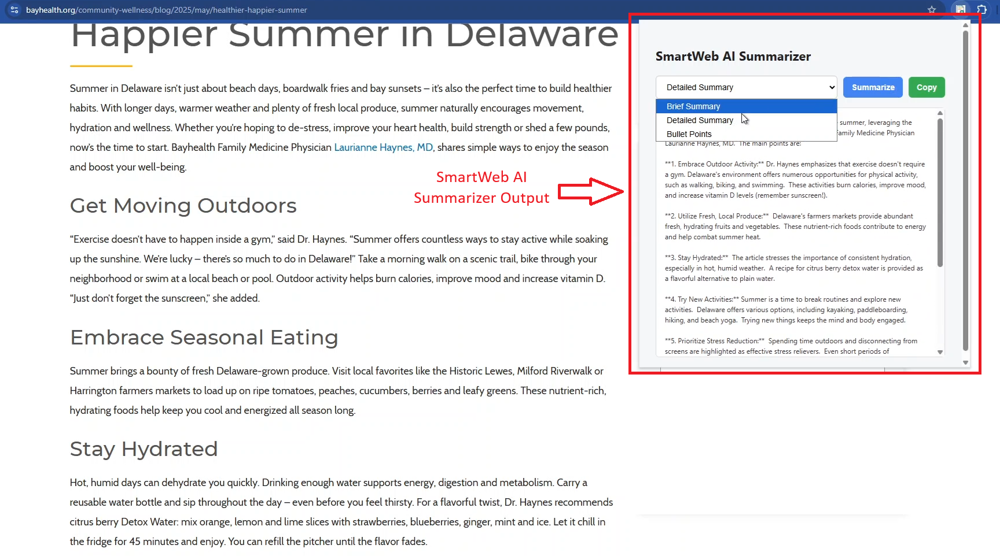

# 🧠 SmartWeb AI – Chrome Extension for Web Summarization



SmartWeb AI is a Chrome Extension that summarizes web articles instantly using Google's Gemini AI API. Select your preferred summary format (brief, detailed, or bullet points) and get instant insights from any webpage.

---

## 🚀 Features

- 🌐 Works on most websites with readable content
- 📑 Choose between Brief, Detailed, or Bullet Summary
- 🧠 Powered by Google Gemini API
- 💾 Stores API key securely using Chrome Sync Storage
- 🪄 Clean UI with loading indicator and copy-to-clipboard

---

## 🔧 Installation (Run Locally)

1. **Clone or download this repository**
   ```bash
   git clone https://github.com/your-username/smartweb.git
   cd smartweb
   ```

2. **Open Chrome and navigate to:**
   ```
   chrome://extensions/
   ```

3. **Enable Developer Mode** (top right).

4. **Click "Load unpacked"** and select the project folder (the one with `manifest.json`).

5. **Pin the extension** to the Chrome toolbar for easier access.

---

## 🔐 Get Your Gemini API Key

1. Go to [Google AI Studio](https://makersuite.google.com/app/apikey)
2. Sign in with your Google account.
3. Generate a new API key.
4. Copy the API key.

---

## ⚙️ Set Up API Key

1. Click the extension icon → click **"Options"**.
2. Paste your **Gemini API key** into the input box.
3. Click **Save Settings**.

---

## 📘 How to Use

1. Navigate to any article or readable webpage.
2. Click the **SmartWeb AI** extension icon.
3. Choose the summary type: **Brief**, **Detailed**, or **Bullet Points**.
4. Click **"Summarize"**.
5. The summary will appear within seconds.
6. Use **"Copy"** to copy the summary to your clipboard.

---

## 📁 Project Structure

```
smartweb/
├── background.js         # Optional background logic
├── content.js            # Extracts article content from pages
├── popup.html            # Main UI
├── popup.js              # Handles summary logic
├── options.html          # API key settings page
├── options.js            # Save/load API key from storage
├── config.js             # Gemini API call helper
├── manifest.json         # Chrome extension configuration
└── icon.png              # Extension icon
```

---

## 🛠 Technologies Used

- Chrome Extensions API (Manifest V3)
- JavaScript (ES6+)
- HTML/CSS
- Google Gemini API (via REST)

---

## 📦 Build & Publish (Optional)

To publish on Chrome Web Store:

1. Zip all files (excluding `.git`, `node_modules`, etc.).
2. Go to [Chrome Web Store Developer Console](https://chromewebstore.google.com/u/0/developer/dashboard)
3. Pay one-time $5 fee if not already.
4. Click **"Add Item"**, upload the ZIP, and fill in details.

---

## 🧠 Credits

Built by Yash (https://github.com/yasharyawork-rgb) using Google’s Gemini AI.

---

